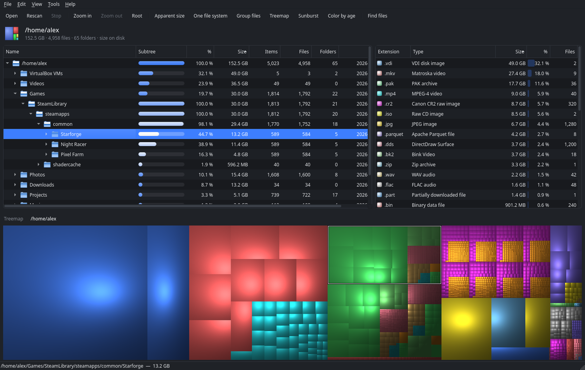
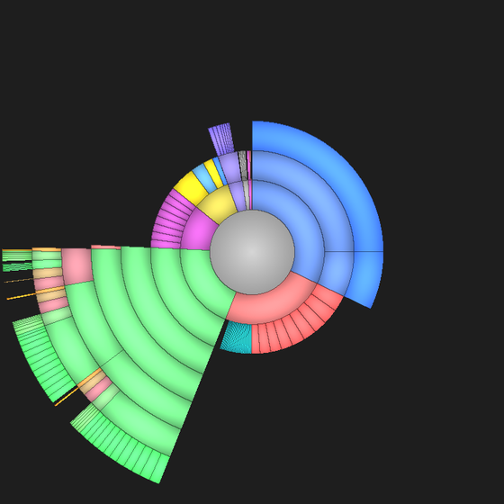
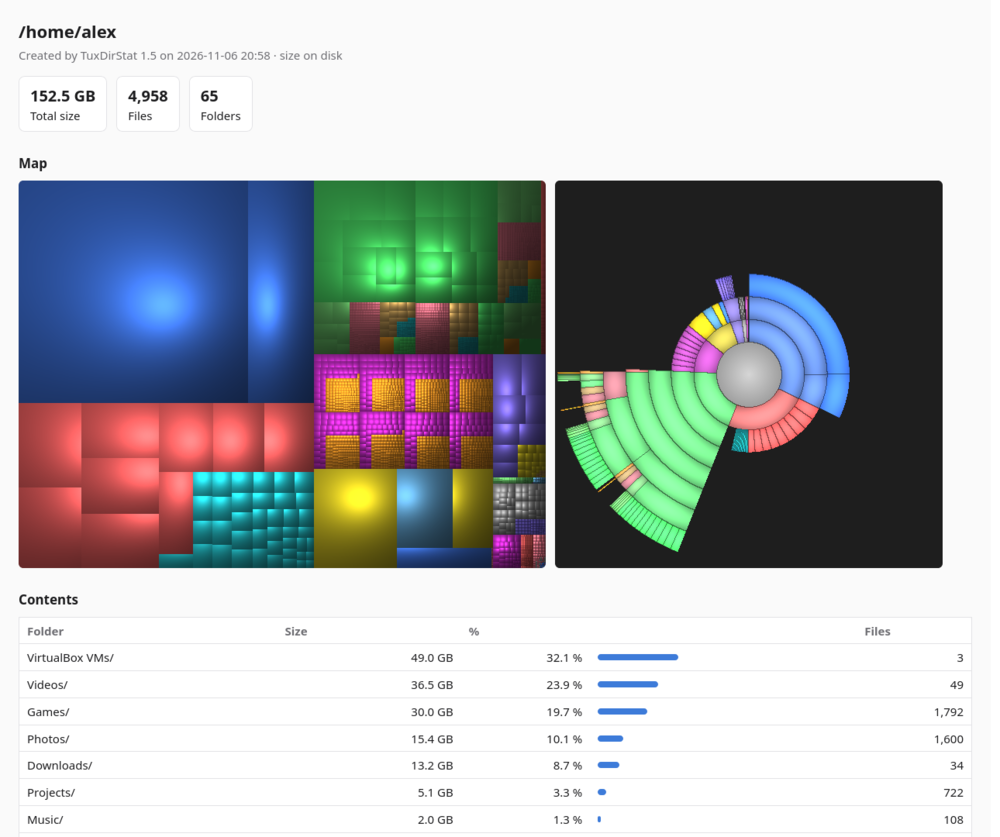

# TuxDirStat

A fast disk usage analyzer for Linux in the spirit of WinDirStat: a folder tree sorted by size,
a list of file types and a shaded (cushion) treemap where every file is a box. The multithreaded
scanner reads millions of files in seconds.

*Türkçe özet [aşağıda](#türkçe).*



The same core has five interfaces, each a separate program:

| Program           | Toolkit        | CMake option                    |
|-------------------|----------------|---------------------------------|
| `tuxdirstat`      | Qt 6           | `TUXDIRSTAT_QT` (on by default) |
| `tuxdirstat-gtk3` | GTK 3          | `TUXDIRSTAT_GTK3`               |
| `tuxdirstat-gtk4` | GTK 4          | `TUXDIRSTAT_GTK4`               |
| `tuxdirstat-tk`   | Tcl/Tk         | `TUXDIRSTAT_TK`                 |
| `tuxdirstat-tui`  | terminal (ncurses) | `TUXDIRSTAT_TUI` (on by default) |

## Features

- **Tree, extension list and treemap** that stay in sync; zoom into folders in the treemap.
- **Sunburst view** (F7): the folder in the middle, each ring one level deeper.
- **Grouping** of the thousands of small asset files games ship with (`*.dds (1,500 files)`).
- **Duplicate files**: compares sizes, then the first 64 KB, then whole files. Hard links are not
  counted as duplicates, and you are warned before deleting every copy.
- **Cleanup suggestions**: `node_modules`, CMake and Cargo build folders, Python caches,
  `~/.cache`, trash, unfinished downloads, Steam shader cache, the pacman cache, orphaned packages,
  the systemd journal, crash dumps and unused Docker, Podman and Flatpak data. Things that need
  root are shown as a command for you to run, never run for you.
- **Scan other computers over SSH**: type `pi:/home` (or `ssh://host/path`) as the location. Uses
  TuxDirStat on the other side when it is installed and plain GNU `find` otherwise, so nothing has
  to be installed there. Files of a remote scan can't be deleted from here.
- **Size history**: *Tools → Record size history weekly* saves the folder's size every week
  (a systemd user timer); *Size history* shows how every folder grew, with a trend line.
- **Reopens the last scan** at start, instantly; press F5 to scan again.
- **Snapshots**: save a scan and open it later without rescanning, or **compare** it with today to
  see what grew. The format is ncdu's JSON export, so `ncdu -o` files open too. Names ending in
  `.gz` are compressed.
- **Search** by name, size, age, type, extension, owner or path: `*.iso >1G older:1y`.
- **Color by age**: color the treemap by when files last changed, to spot forgotten data.
- **Exports**: an HTML report with treemap and sunburst images, the map as a PNG image, CSV.
- **Installed packages**: pacman packages and Flatpak apps by size, orphans marked.
- **Btrfs**: how much of a folder is shared with snapshots or reflinked copies (deleting it frees
  nothing) and how much is stored compressed, per folder and per subvolume.
- **Arch Linux**: see which package owns a file, and list files under `/usr`, `/etc` and `/opt` that
  no package owns (leftovers, manual installs).
- **Administrator scan**: a read-only scan through `pkexec` for folders your user cannot read.
  Deleting still uses your own rights.
- **File manager menus**: *Analyze disk usage with TuxDirStat* in Dolphin, Nautilus and Nemo.
- Usage by owner, light and dark themes, **English and Turkish** (more welcome, see
  [Translations](#translations)), app icon, man page and shell completions.

<p>


</p>

## Install

Arch Linux (once the AUR packages are up): `tuxdirstat` or `tuxdirstat-git`. Until then you can
build the same package from this repository:

```sh
git clone https://github.com/Gubir34/TuxDirStat.git
cd TuxDirStat/packaging/aur/tuxdirstat-git && makepkg -si
```

Other packages in [`packaging/`](packaging): a Flatpak manifest (Flathub), an RPM spec (Fedora
COPR, openSUSE) and an AppImage build script. Release pages get an AppImage automatically.

Into `~/.local` on any distribution:

```sh
./install.sh             # Qt only
./install.sh gtk4 tui    # chosen interfaces (qt, gtk3, gtk4, tk, tui)
./install.sh all         # all five
```

You need `cmake`, `ninja`, a C++20 compiler, `python`, `zlib` and the development packages of the
chosen toolkit (`qt6-base`, `gtk3`, `gtk4`, `tk`, `ncurses`; the Tk interface also uses
`glib2`/GIO). Optional: `polkit` for administrator scans, `openssh` for remote scans,
`pacman-contrib` for `paccache`, `compsize` for the btrfs view, `zstd`/`xz` to open compressed
snapshots, `python-nautilus` for the Nautilus menu.

Building by hand:

```sh
cmake -S . -B build -G Ninja -DTUXDIRSTAT_GTK4=ON -DTUXDIRSTAT_TESTS=ON
cmake --build build
ctest --test-dir build
```

## Using it

```sh
tuxdirstat                  # reopens the last scan (or asks what to scan)
tuxdirstat ~/Games          # scans right away
tuxdirstat home.json        # opens a saved snapshot
tuxdirstat pi:/home         # scans /home on the computer "pi" over SSH
tuxdirstat-tui /var         # in the terminal
```

- Clicking an item in the tree or the treemap selects it in the other.
- Double-click in the treemap zooms into a folder; **Backspace** goes back.
- Selecting a row in the extension list marks those files in the treemap.
- Right-click: open, show in file manager, copy path, which package owns it, rescan, trash, delete.
- The **Tools** menu has search, duplicates, cleanup suggestions, usage by owner, files no package
  owns, installed packages, the btrfs view, snapshot comparison and size history. Results open in
  a window where you can show an item in the tree, open its folder, copy its path (or the
  suggested command) and move items to the trash.

| Shortcut | Action |
|---|---|
| Ctrl+O | Choose a location |
| F5 | Rescan |
| Esc | Stop the scan |
| Ctrl+F | Find files |
| Ctrl+S | Save snapshot |
| Ctrl++ / Backspace / Ctrl+0 | Zoom in / out / back to the root |
| Ctrl+G | Group files |
| F7 | Sunburst |
| F8 | Color by age |
| F9 | Show or hide the treemap |
| Delete / Shift+Delete | Move to trash / delete permanently |
| Ctrl+C | Copy path |

### Terminal interface

`tuxdirstat-tui` browses a scan like `ncdu`, with the same scanner, settings, search syntax and
remote scans. Press `?` for the keys: arrows to move and open folders, `s`/`n`/`c`/`m` to sort,
`d` to trash, `D` to delete, `/` to find, `t` for file types.

```
 TuxDirStat 1.5  /home/alex
 Total: 152.5 GB · 4,958 files · 65 folders  ·  size on disk
    49.0 GB  32.1 % [█████▏          ]         5  VirtualBox VMs/
    36.5 GB  23.9 % [███▉            ]        49  Videos/
    30.0 GB  19.7 % [███▏            ]     1,814  Games/
    15.4 GB  10.1 % [█▋              ]     1,608  Photos/
    13.2 GB   8.7 % [█▍              ]        34  Downloads/
     5.1 GB   3.3 % [▌               ]       739  Projects/
```

### Search syntax

Words match file names (`*` and `?` are wildcards; without them, any part of the name matches).
Filters can be combined:

| Filter | Meaning |
|---|---|
| `>100M`, `<1G` | size (K, M, G, T) |
| `older:1y`, `newer:2w` | last change (h, d, w, m, y) |
| `type:f`, `type:d` | only files or only folders |
| `ext:mp4,mkv` | extensions |
| `user:name` | owner |
| `path:Steam` | text anywhere in the path |

### Scanning over SSH

Write the location as `host:/path` (in the location picker's *Other computer* field or on the
command line). The host can be anything `ssh` understands, including names from `~/.ssh/config`.
TuxDirStat needs key login without a password prompt: check that `ssh host` works in a terminal
first. If TuxDirStat 1.5 or newer is installed on the other computer it does the scan there;
otherwise GNU `find` lists the files. Remote scans are read-only.

### Size history

*Tools → Record size history weekly* saves the current scan right away and installs a systemd
user timer (`tuxdirstat-history.timer`) that records the folder every week; the folders are listed
in `~/.config/tuxdirstat/history.conf`. *Tools → Size history* (or `tuxdirstat --history PATH`)
shows each top-level item at every recorded date with a trend line. Up to 60 records per folder
are kept in `~/.local/share/tuxdirstat/history/`.

### Btrfs

On btrfs, deleting a file that is also in a snapshot (Snapper, Timeshift) or that was copied with
reflinks frees nothing until the other copies are gone, and `du` shows compressed files at their
full size. *Tools → Btrfs: shared and compressed data* shows both per top-level folder and per
subvolume, without root. Run `sudo tuxdirstat --btrfs PATH` with `compsize` installed to also see
the compressed size on disk.

### Grouping

With **Group files** on, a folder with at least *threshold* similar items (16 by default, 8–128
selectable) collects them into one virtual node: files with the same extension, small files (under
1 % of the folder) and small subfolders. The treemap draws a group as one block; double-click to go
inside. Deleting a group deletes the files in it.

### "One file system"

When on, the scan does not cross into other disks or mount points; btrfs subvolumes of the same
device (such as `/home` and `/var/log`) are still included. Virtual file systems like `/proc` and
`/sys` are always skipped.

## Command line

Every program also works without a window when you give it an output option. They can be combined:

```sh
tuxdirstat --report --group --top 10 ~/.local/share/Steam/steamapps/common
tuxdirstat --find '*.iso >1G older:1y' ~
tuxdirstat --duplicates --cleanup ~
tuxdirstat --export home-$(date +%F).json.gz ~    # snapshot (ncdu JSON, compressed)
tuxdirstat --compare home-2026-10-01.json.gz ~    # what changed since then
tuxdirstat --html report.html --png map.png ~     # HTML report and treemap image
tuxdirstat --report pi:/srv                       # over SSH
tuxdirstat --packages                             # installed packages by size
tuxdirstat --btrfs /home                          # shared and compressed data
tuxdirstat --import home.json --csv home.csv      # snapshot to CSV
sudo tuxdirstat --unowned /                       # Arch: files no package owns
```

Other options: `--sunburst FILE`, `--size WxH`, `--history`, `--owners`, `--apparent`,
`--group-min N`, `--all-fs`, `--lang CODE`. `--export -` writes to standard output. See
`tuxdirstat --help` or `man tuxdirstat`. Bash, zsh and fish completions are installed.

## Language, theme and settings

The interface follows your locale. You can choose the language under *View → Language* (Qt), the
menu button (GTK) or *View* (Tk); the change applies after a restart. **System** theme follows the
desktop; **Light** and **Dark** can be forced in every interface.

Size mode, one file system, grouping, threshold, theme, language, age coloring, sunburst, treemap
visibility and reopening the last scan are stored in `~/.config/tuxdirstat/settings.conf`, shared
by all interfaces.

## Translations

Translations are gettext `.po` files in [`po/`](po), compiled into the programs at build time.
To add a language, copy `po/tuxdirstat.pot` to `po/<code>.po` (for example `po/de.po`), fill in
the header (`Language`, `X-Language-Name`, the number and date formats) and the `msgstr` lines,
and rebuild: the language shows up in the menu by itself. `%1`, `%2`… are placeholders and must
stay. `tests/check_i18n.py` (run by `ctest`) reports missing strings; `--merge` adds new strings
to every `.po` file and `--update-pot` refreshes the template.

## Project layout

```
src/core/       scanner, data model, grouping, treemap and sunburst renderer, tools, snapshots,
                remote scans, size history, exports, i18n, command line
src/qt/         Qt 6 interface
src/gtk/        GTK 3 / GTK 4 interface (one source)
src/tk/         Tk interface (embedded Tcl script + C++)
src/tui/        terminal interface (ncurses)
po/             translations and the tools that compile them
data/           icon, AppStream metadata, man page, file manager menus
completions/    bash, zsh and fish completions
packaging/      AUR PKGBUILDs (+ publish script), Flatpak manifest, RPM spec, AppImage script
tests/          core unit tests and the translation check
```

## License

TuxDirStat is released under the [GNU General Public License version 3](LICENSE) (GPL-3.0-or-later).

## Türkçe

TuxDirStat, Linux için WinDirStat tarzında bir disk kullanım analizörüdür: boyuta göre sıralı klasör
ağacı, dosya türü listesi, gölgeli treemap ve halka (sunburst) görünümü. Kopya dosya bulma, temizlik
önerileri, SSH ile başka bilgisayarları tarama, haftalık boyut geçmişi, anlık görüntü kaydetme ve
karşılaştırma, arama, yaşa göre renklendirme, HTML raporu ve PNG görüntüsü, kurulu paketler, btrfs
paylaşım/sıkıştırma görünümü, pacman denetimleri ve yönetici olarak (salt okunur) tarama içerir.
Qt, GTK 3, GTK 4, Tk ve terminal (`tuxdirstat-tui`) arayüzleri vardır. Arayüz dili sistem diline
uyar; *Görünüm → Dil* menüsünden değiştirilebilir. Çeviriler `po/` klasöründedir. Komut satırı
seçenekleri için `tuxdirstat --help` ya da `man tuxdirstat`.
